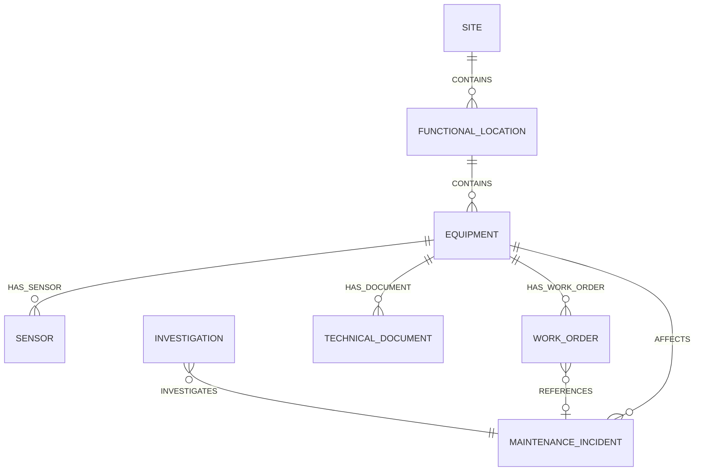

# Architecture

## Runtime

Local mode reads CSV and Markdown through `LocalRepository`. CDF mode uses `CdfRepository` and cognite-sdk 8.23 or newer. Hybrid mode uses the same CDF client and the mock investigator when AI credentials are absent.

Detection, ranking, health, and recommendation rules do not call CDF. Scripts and the function entry points call those services and then persist the result.

Toolkit containers use direct relations for parent, equipment, and incident links. The Python ingestion path can also write named edges (`CONTAINS`, `HAS_SENSOR`, `HAS_WORK_ORDER`, `HAS_DOCUMENT`, `AFFECTS`, `INVESTIGATES`, `REFERENCES`) with `EdgeApply`. Edge instances are not required for the local demo.

## Detection

Rules are in `config/anomaly_rules.yaml`. A minute counts only when `M101_MOTOR_SPEED_RPM >= 1400`. A run must last for the rule duration. Same-severity runs separated by fewer than 15 idle minutes become one incident. Warning and critical runs stay separate so the degradation and the final four hours are both visible.

The statistical detector uses a rolling median and median absolute deviation. Its intervals are not turned into incidents.

## Health score

Start at 100.

| Signal | Critical deduction | Warning deduction |
| --- | --- | --- |
| Drive-end vibration | 18 at or above 7.1 mm/s | 10 at or above 4.5 mm/s |
| Drive-end bearing temperature | 16 at or above 82 °C | 8 at or above 75 °C |
| Flow | 12 at or below 82 m³/h | 6 at or below 88 m³/h |
| Motor current | 8 at or above 46 A | 5 at or above 44 A |

Add 8 when three or more of those signals are in a warning or critical band. Cap critical results at 45 and warning results at 75. Clamp to 0–100.

The designed critical window scores 38. The score does not estimate the probability of failure, and it ignores sensors that are not in the table.

## AI boundary

`MockInvestigator` is deterministic and sufficient for the demo. `OpenAICompatibleProvider` posts to a chat-completions URL when configured. Document text is placed in the user payload and described as untrusted. Responses must match the Pydantic schema and may cite only evidence ids from the context. Failure retries once, then returns a fallback that does not invent sources.

## Idempotency

Incident ids are `INC-P101-YYYYMMDD-HHMM` from the interval start. Repeating detection over the same file replaces the same ids. Asset, sensor, work-order, and document writes also upsert by external id.
