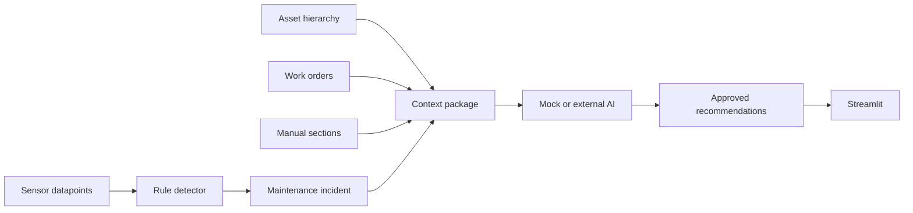

# MaintIQ

Evidence-based maintenance investigation for a fictional cooling-water pump in Cognite Data Fusion (CDF).

Sensor anomaly → asset context → maintenance history → technical documents → AI investigation → evidence-based recommended actions.

The primary story is drive-end bearing degradation on **PUMP-P101** at the Chennai Manufacturing Demo Site. The application separates observed facts, detected anomalies, historical evidence, manual guidance, and AI hypotheses. A hypothesis is not a confirmed diagnosis.

## Business problem

Maintenance teams often see a bad sensor trend without the asset, work-order, and procedure context needed to decide the next check. This proof of concept assembles that context and recommends actions a person must approve.

## Scope

Included:

- A 14-day, one-minute synthetic history for Pump P-101 and its motor, valve, and bearings.
- Rule-based detection with shutdown exclusion, spike suppression, and incident merging.
- Ranked work orders and maintenance-manual sections.
- A deterministic mock investigator that cites only supplied evidence.
- A Streamlit application for local, CDF, and hybrid modes.
- A Cognite Toolkit 0.9 module for a development project.

Not included:

- Automatic equipment shutdown or work-order creation.
- A production CDF deployment.
- Native CDF document AI. Section parsing is the documented fallback.

## Architecture



See [ARCHITECTURE.md](ARCHITECTURE.md) for the data model and health-score formula.

## Data flow

1. Read recent sensor data.
2. Validate completeness, duplicates, and ranges.
3. Calculate rate of change, robust z-scores, and the health score.
4. Detect sustained warning and critical conditions while the pump is at running speed.
5. Create or update incidents. The same interval keeps the same external id.
6. Retrieve the asset, ranked work orders, and manual sections.
7. Generate a schema-validated investigation.
8. Persist the investigation.
9. Show it in Streamlit.
10. Store a notification payload. Nothing is sent to Teams, email, or Slack.

## Repository structure

`src/maintenance_investigator` holds the domain code. `app` is the Streamlit UI. `config` holds rules and recommendation templates. `data/source` holds master data and the synthetic manual. `modules/maintenance_investigator` is the Toolkit module. `scripts` runs generation, validation, and optional CDF steps.

Toolkit 0.9.60 uses `auth/` for groups and `data_modeling/` for spaces, containers, views, and data models. Those folders replace the generic `groups/` and `data_models/` names.

## Prerequisites

- Python 3.11 or newer. This workspace was exercised on Python 3.13.
- Optional: Cognite Toolkit 0.9.x (`cdf` on the path) for `cdf build`.
- Optional: a development CDF project. Local mode needs no credentials.

## Local quick start

```text
python -m venv .venv
```

Windows PowerShell:

```text
.venv\Scripts\Activate.ps1
```

Linux/macOS:

```text
source .venv/bin/activate
```

Then:

```text
python -m pip install --upgrade pip
pip install -e ".[dev]"
python scripts/01_generate_sample_data.py
python scripts/02_validate_sample_data.py
pytest
streamlit run app/Home.py
```

Makefile targets: `make install`, `make generate-data`, `make validate-data`, `make test`, `make lint`, `make run`, `make demo`, `make cdf-deploy`, `make cdf-ingest`, `make clean-demo`.

## CDF configuration

Copy `.env.example` to `.env` and fill the development project values there. Do not commit `.env`.

`APP_MODE` accepts:

- `local` — CSV, Markdown, and JSON. Mock AI. No CDF credentials.
- `cdf` — read and write through CDF. Credentials are required.
- `hybrid` — CDF for data. Mock AI when the AI endpoint or key is empty.

`AI_PROVIDER` accepts `mock` and `openai_compatible`. In local and hybrid mode, a missing AI key falls back to the mock investigator.

## Cognite Toolkit commands

The module targets Toolkit 0.9. The committed `cdf.toml` records module version `0.9.79`, which is the CLI that built and validated the module. Earlier 0.9 releases with the same minor version can load it when they accept the same fields. `config.dev.yaml` selects the module and uses the placeholder project name `maintenance-investigator-dev`. Replace that name, the data-set id in the group example, and the identity-provider group id before use.

```text
cdf build
cdf deploy --dry-run
```

`python scripts/03_deploy_cdf_resources.py` prints these commands and does not deploy. Deploy only to the configured development project, and only after reviewing the build.

## Data generation

```text
python scripts/01_generate_sample_data.py
```

The generator uses random seed 42. It writes master-data CSV files, `data/generated/pump_sensor_data.csv`, and `data/expected/expected_incidents.json`. Ground-truth labels are for validation. Detection drops them before scoring rules.

## CDF ingestion

```text
python scripts/04_ingest_master_data.py
python scripts/05_ingest_time_series.py
python scripts/06_ingest_work_orders.py
python scripts/07_ingest_documents.py
```

Local mode updates `data/local_store`. CDF uploads run when `APP_MODE` is `cdf` or `hybrid` and the development credentials are present. Time-series inserts use UTC millisecond timestamps.

## Running detection

```text
python scripts/08_run_detection.py
```

Rules live in `config/anomaly_rules.yaml`. The pump is treated as operating when motor speed is at least 1400 rpm, so planned shutdown and start-up do not raise equipment-failure incidents. A single-point spike cannot satisfy a 5- or 10-minute duration. Same-severity gaps shorter than 15 minutes merge. A rise from warning to critical opens a second incident.

## Running the investigation

```text
python scripts/09_create_investigations.py
```

The mock investigator returns the schema in section 12 of the design. Citations that are not in the context are rejected. Invalid model output is retried once and then replaced by a safe fallback. Every recommended action requires human approval.

## Starting Streamlit

```text
streamlit run app/Home.py
```

The sidebar shows the mode. CDF and hybrid modes attempt authentication and stop with a safe error if it fails. Charts in this POC use the local extract so the story stays available after authentication.

## Running tests

```text
pytest
ruff check .
ruff format --check .
```

Markers: `unit`, `integration`, `cdf`, `slow`. The CDF test is skipped when `CDF_PROJECT`, `CDF_CLIENT_ID`, and `CDF_CLIENT_SECRET` are unset.

## Troubleshooting

- Missing sensor file: run `python scripts/01_generate_sample_data.py`.
- `APP_MODE=cdf` fails at startup: a required variable is blank. The error names the variable and does not print the secret.
- Toolkit build reports an unknown field: this module was written for Toolkit 0.9 resource classes. Do not add fields that the installed version rejects.
- The UI is empty: generate data, then use Refresh cached data in the sidebar.

## Security notes

Read [SECURITY.md](SECURITY.md). Sample data is synthetic. Recommendations are decision support.

POC decision-support output. Verify evidence and follow approved site safety and maintenance procedures before taking action.

## Known limitations

- The health score is a penalty model, not a probability of failure. The full critical pattern scores 38 and is then eligible for the critical cap of 45.
- Statistical z-score flags are separate from incidents.
- Document linking uses the Markdown section parser, not CDF document extraction.
- Classic CDF events are built and not written unless `CDF_WRITE_CLASSIC_EVENTS=true`.
- The Toolkit group example uses placeholder data-set and group ids.
- Docker is optional. The local demo does not need it. The image expects the generated CSV to be present because the Dockerfile copies `data/`.

## Future enhancements

- Vendor the Python package into the Cognite Function bundles and schedule the workflow.
- Replace the section parser with CDF document contextualization behind the same passage interface.
- Let an approved user create a work order through `DisabledWorkOrderGateway`.
- Add a notification sender only behind an explicit configuration flag.
